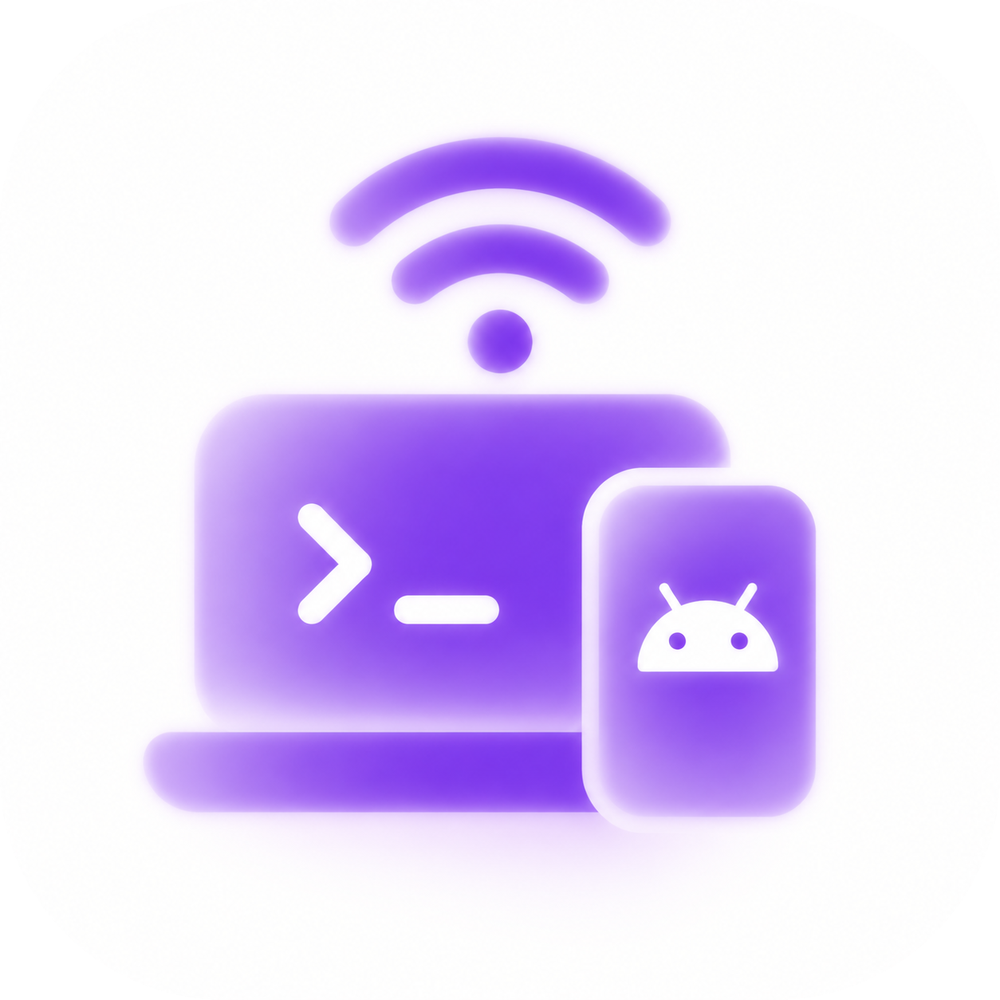
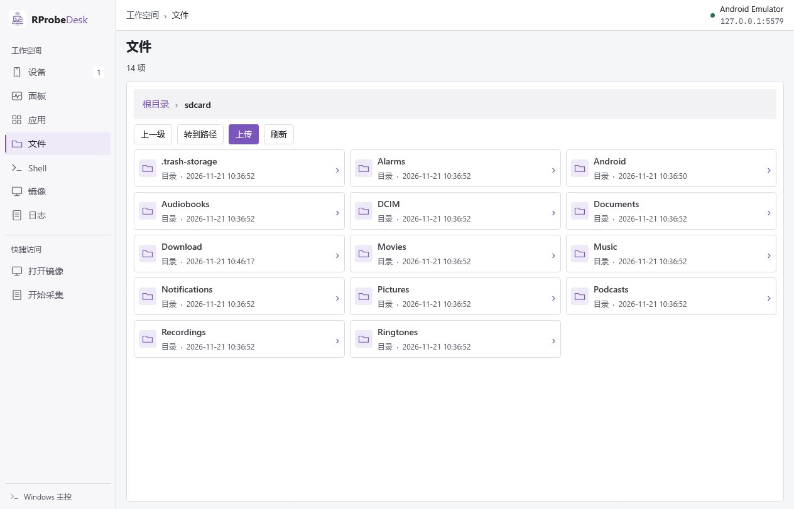
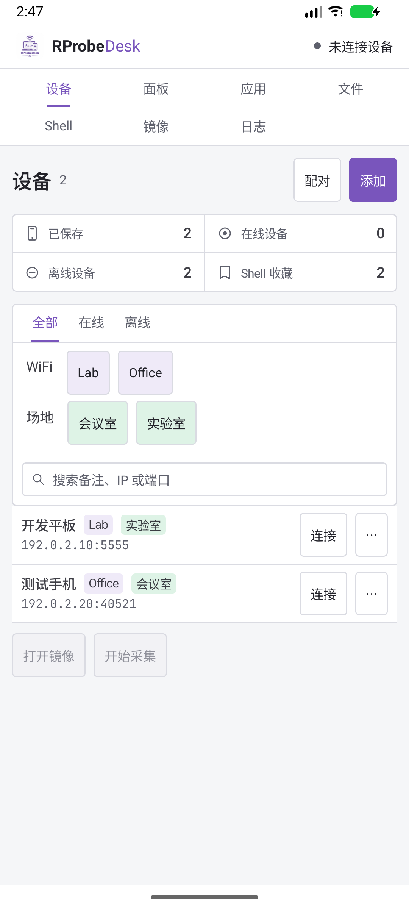

<div align="center">
  
  <h1>RProbeDesk</h1>
  <p>Windows 与 Android 上的无线 ADB 调试工作台</p>
  <p>
    
    
    
    
  </p>
  <p>by <a href="https://github.com/rurikacy">Rurikacy</a> · <a href="README_EN.md">English</a></p>
  <p><a href="https://github.com/rurikacy/RProbeDesk/releases">下载发行版</a> · <a href="#screenshots">界面预览</a> · <a href="#quick-start">快速开始</a> · <a href="#build">源码构建</a> · <a href="SUPPORT.md">使用支持</a></p>
</div>

---

## 📖 简介

RProbeDesk 可以把 Windows 电脑或 Android 手机、平板作为主控，通过 Wi-Fi ADB 调试另一台 Android 设备。例如，在「应用」里安装测试包，点开「镜像」重现问题，再回到「日志」导出刚才的报错。当前目标的备注始终显示在顶栏。

两端共享 Kotlin 设备管理逻辑和 Compose Multiplatform 界面，连接和传输直接在本机与目标之间完成。应用界面为简体中文，使用固定浅色主题。

<a id="screenshots"></a>

## 🖼️ 界面预览

**Windows 工作台**

<p align="center"></p>

**Android 工作台**

<p align="center"></p>

## ✨ 功能

| 工作区 | 可以做什么 |
| --- | --- |
| 设备 | 按 IP 和端口配对、连接，保存备注，搜索设备和切换当前目标。 |
| 面板 | 通过圆环查看 CPU、GPU、内存、数据分区占用和系统负载，核对型号、系统、网络、屏幕与电池信息，或保存目标截图。 |
| 应用 | 按包名查找，启动、停止、冻结、解冻、卸载。安装本地 APK，或从直链下载单个 APK，核对来源、包名和版本后安装。 |
| 文件 | 浏览目标目录，上传、下载文件，或在目标的同一存储卷内移动文件。覆盖同名文件前会要求确认，Android 主控通过系统文件选择器指定本地文件或保存位置。 |
| Shell | 在目标上执行命令，查看输出和退出状态，将常用命令命名收藏并再次运行。 |
| 镜像 | 在 Windows 独立窗口或 Android 镜像视图里点击、拖动、输入文字和发送按键，画面随目标旋转。 |
| 日志 | 手动采集 logcat，按等级、Tag、PID 和关键词筛选，查看带颜色的日志与堆栈，暂停显示并导出筛选结果。 |

<a id="quick-start"></a>

## 📥 快速开始

选择安装在**主控端**的包。目标端使用系统自带的「无线调试」。两端应在同一 Wi-Fi 上，且网络允许设备之间互相访问。[下载 v1.2.0](https://github.com/rurikacy/RProbeDesk/releases/tag/v1.2.0)

| 主控环境 | 安装包 | 准备工作 |
| --- | --- | --- |
| Windows x64 | `RProbeDesk-1.2.0-windows-x64.msi` | MSI 包含 Temurin 17 运行时。连接需要 Android SDK Platform-Tools 的 `adb.exe`，使用镜像时还需要 `scrcpy.exe`。可分别在「设备」和「镜像」页选择路径。[Platform-Tools](https://developer.android.com/tools/releases/platform-tools) · [scrcpy Windows 安装说明](https://github.com/Genymobile/scrcpy/blob/v3.3.4/doc/windows.md) |
| Android 11 及以上 | `RProbeDesk-1.2.0-android.apk` | 安装 APK 即可。主控使用包内的 ADB 客户端和镜像组件，无线调试在被控设备上开启。 |

下载完成后，可用 PowerShell 的 `Get-FileHash -Algorithm SHA256 .\RProbeDesk-1.2.0-windows-x64.msi` 与同一发行页的 `SHA256SUMS.txt` 核对。验证 APK 时替换文件名即可。

1. 在**目标设备**打开「设置 → 开发者选项 → 无线调试」，允许当前网络。记下主页上的 **IP 地址和连接端口**。Android 11 及以上手机和平板可通过系统配对码授权。[Android 无线调试指南](https://developer.android.com/tools/adb#wireless)
2. 在主控端打开「设备 → 配对」。如果目标已允许直接连接，填写 IP 和**连接端口**，配对码留空，点「保存并连接」即可进入面板。如果目标要求配对，在目标上点「使用配对码配对设备」，填写弹窗中的**配对端口**和**六位配对码**，再继续以下步骤。
3. 在主控的「设备 → 添加」里填写目标 IP、无线调试主页上的 **连接端口** 和备注，例如「测试平板」，然后保存。
4. 在已保存的设备行点「连接」。Android 主控首次核对目标身份时，还会要求输入目标通知栏显示的八位数字。连接成功后，在「面板」核对型号并查看采样数据。

端口可能在重启无线调试或换网络后变化，可编辑原记录后重连。要撤回某台主控的权限，请在目标的「无线调试 → 已配对设备」中忘记该主控。

## 🧭 日常使用

- **调试应用。** 在「应用」点「安装 APK」或「从链接安装」，确认目标用户和包信息。需要重现故障时，先在「日志」开始采集，再进入镜像操作。Android 主控在前台跨页期间持续采集，退到后台会记录中断，返回后可手动续采。
- **收藏命令。** 在「Shell」运行 `getprop ro.product.model`，可与面板型号对照。点「收藏命令」为命令命名，以后连接设备即可在收藏行点「运行」。
- **输入中文。** Android 主控在镜像工具栏点「输入文字」并发送。Windows 可复制文字，让镜像中的目标输入框获得焦点，再按 scrcpy 默认的 **左 Alt+V** 粘贴。
- **核对状态。** 温度注明测点，设备未公开的指标会显示缺失。冻结作用于目标当前 Android 用户，解冻可恢复。遇到断线后提示「结果待核实」，请重连原设备并刷新包列表或目标目录。

<a id="build"></a>

## 🔧 源码构建与测试

在 Windows x64 开发机上准备 JDK 17、Android SDK Platform 35 与 Build Tools。设置 `ANDROID_HOME`，或在未纳入版本控制的 `local.properties` 中填写 `sdk.dir=C:/Android/Sdk`。构建 MSI 还需要 WiX 3.x 的 `candle.exe` 和 `light.exe` 在 `PATH` 中可用。工程自带 Gradle Wrapper。[JDK 17 打包前提](https://docs.oracle.com/en/java/javase/17/jpackage/packaging-overview.html)

```powershell
.\gradlew.bat :app:run                            # 从源码运行 Windows 工作台
.\gradlew.bat :app:desktopTest                    # 共享逻辑、桌面端与 Compose 界面测试
.\gradlew.bat :app:assembleDebug                  # Android 调试 APK
.\gradlew.bat :app:packageDistributionForCurrentOS # Windows MSI
```

MSI 生成在 `app/build/compose/binaries/main/msi/`，调试 APK 在 `app/build/outputs/apk/debug/`。签名发行 APK 时，设置 `RPROBE_KEYSTORE` 和 `RPROBE_STORE_PASSWORD`，使用别名 `rprobedesk` 及相同的密钥密码，运行 `.\gradlew.bat :app:assembleRelease`。覆盖升级 Android 应用时，新旧版本须使用同一签名身份。

设备与界面逻辑位于 `app/src/shared/kotlin/`，平台适配分别位于 `app/src/desktopMain/` 与 `app/src/androidMain/`。涉及真实 ADB 的测试需要显式指定专用模拟器，测试应用可通过 `.\gradlew.bat :qa:fixture:assembleDebug` 生成。仓库包含双设备配对、镜像、文件传输和日志负载的复验步骤。[Android 无线调试验收](qa/android-wireless/README.md) · [Windows 镜像验收](qa/windows-mirror/README.md)

## 🤝 参与与反馈

反馈时请附上 RProbeDesk 版本、主控平台、目标 Android 版本和复现步骤。涉及连接问题时，注明使用配对端口还是连接端口，并隐去配对码和日志中的个人信息。[使用支持](SUPPORT.md) · [提交 Issue](https://github.com/rurikacy/RProbeDesk/issues)

参与开发前可阅读贡献指南和行为准则。安全问题请通过安全说明中的渠道报告。[贡献指南](CONTRIBUTING.md) · [行为准则](CODE_OF_CONDUCT.md) · [安全说明](SECURITY.md) · [版本记录](CHANGELOG.md)

## 📄 许可证

RProbeDesk 项目代码采用 GNU Affero General Public License v3。随包提供的第三方库、scrcpy server 和字体分别保留其上游许可。[项目许可证](LICENSE.txt) · [第三方声明](THIRD-PARTY-NOTICES.md) · [Android 组件与原始许可](app/src/androidMain/assets/licenses/COMPONENTS.txt) · [字体许可](app/src/commonMain/composeResources/files/licenses/jetbrains_mono-OFL.txt)
