<div align="center">
  
  <h1>RProbeDesk</h1>
  <p>用电脑或手机通过 Wi-Fi 调试 Android 设备，安装应用、操作屏幕、导出日志。</p>
  <p>
    
    
    
    
  </p>
  <p>by <a href="https://github.com/rurikacy">Rurikacy</a> · <a href="README_EN.md">English</a></p>
  <p><a href="https://github.com/rurikacy/RProbeDesk/releases/tag/v1.2.1">下载 1.2.1</a> · <a href="#screenshots">界面预览</a> · <a href="#quick-start">快速开始</a> · <a href="#build">源码构建</a> · <a href="SUPPORT.md">使用支持</a></p>
</div>

---

## 📖 简介

RProbeDesk 适合开发、测试和现场维护 Android 设备的人。把它装在手边的 Windows 电脑、Android 手机或平板上，这台机器就是**主控端**。在要调试的手机、平板或终端上打开无线调试，配对并连接后，就能从主控端查看它的屏幕、运行应用、传文件和执行命令。这些操作通过 Android 调试桥（ADB）在局域网内直接发往目标设备。

- **复现一次闪退。** 在「应用」安装待测 APK，到「日志」开始采集，再打开「镜像」操作目标屏幕。问题出现后，按等级、Tag 或关键词筛选并导出日志，还可以从「面板」保存目标截图，附到问题报告里。
- **排查一台现场终端。** 用 Android 手机作为主控，连接后先看内存和磁盘占用、核对系统版本，再到「Shell」运行常用检查命令，或从「文件」下载目标生成的诊断文件。手机端内置 ADB 客户端和镜像组件。
- **管理多台测试机。** 给设备写备注、记录场地和 WiFi，按场地或网络分组，把常用设备拖到组内靠前的位置。下次到现场时，从已保存的列表选中设备就能重连。通过本地文件或自己的 WebDAV 服务器，可以把整份设备清单转到另一台主控，连同分组方式、设备顺序和 Shell 收藏一起带过去。

<a id="screenshots"></a>

## 🖼️ 界面预览

**Windows**

<table>
  <tr>
    <td width="50%">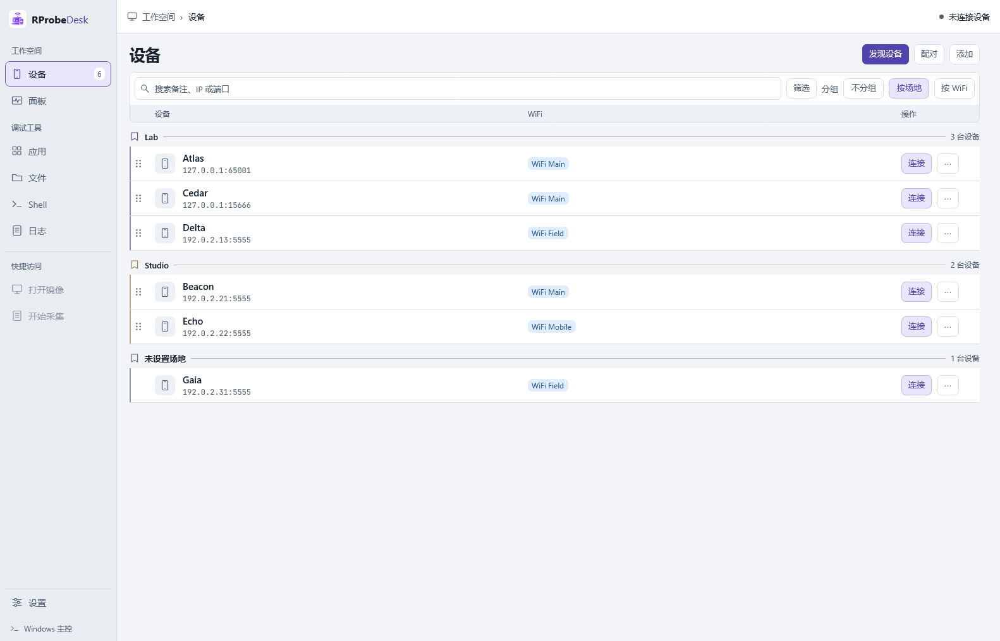</td>
    <td width="50%">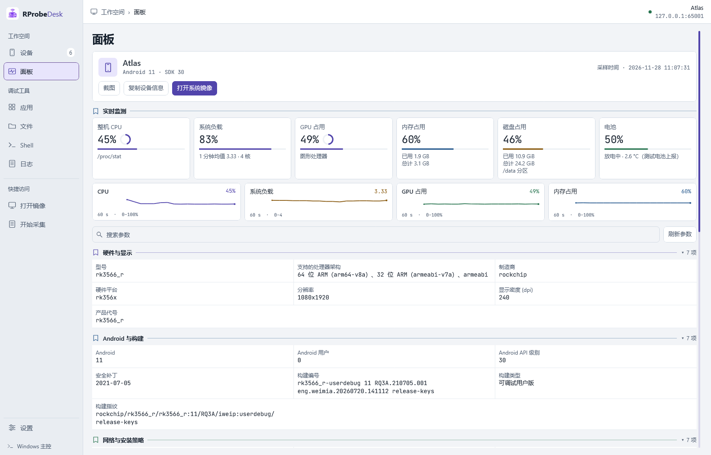</td>
  </tr>
  <tr>
    <td width="50%">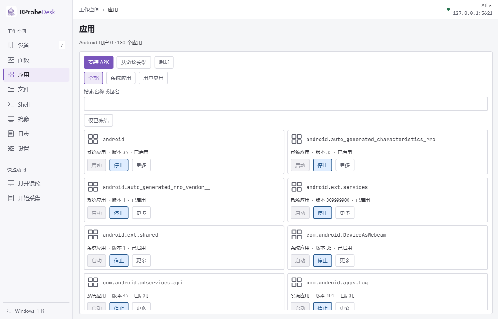</td>
    <td width="50%">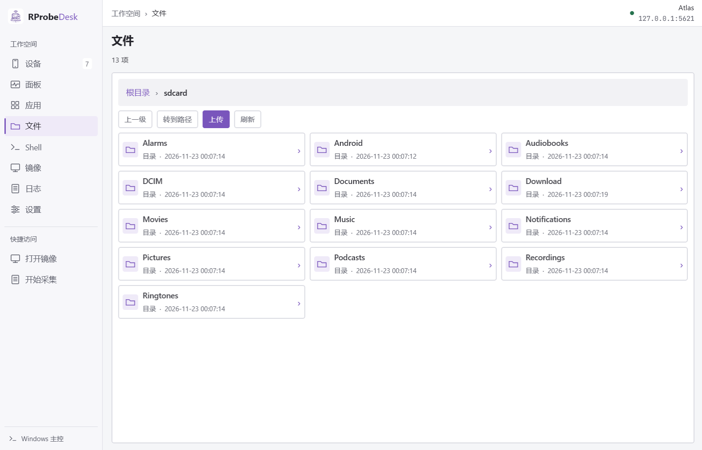</td>
  </tr>
  <tr>
    <td width="50%">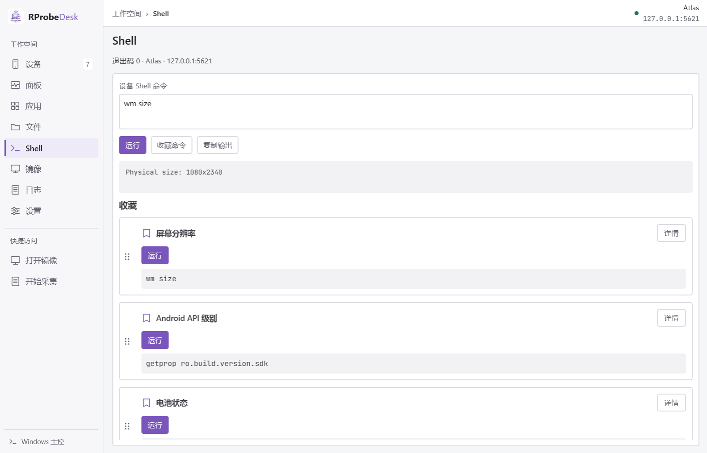</td>
    <td width="50%">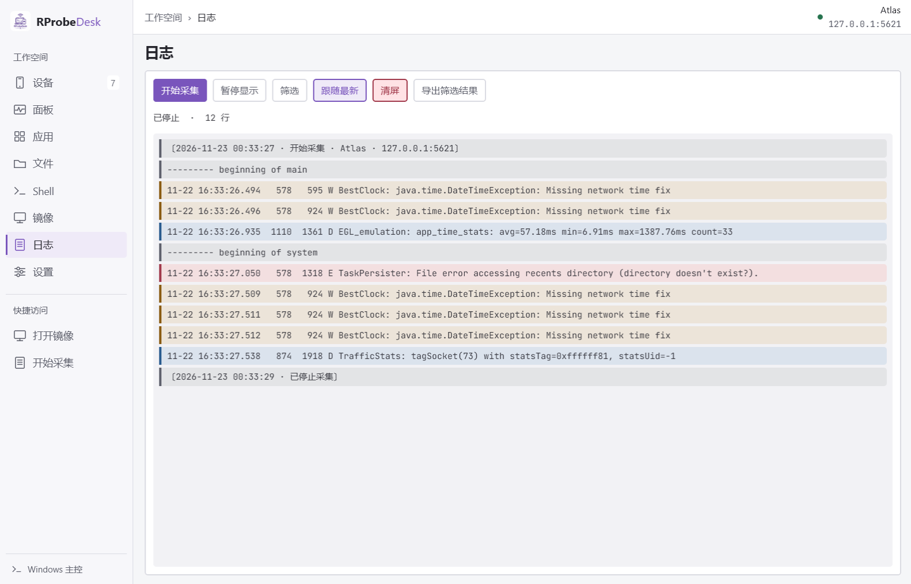</td>
  </tr>
</table>

**Android**

<table>
  <tr>
    <td width="25%">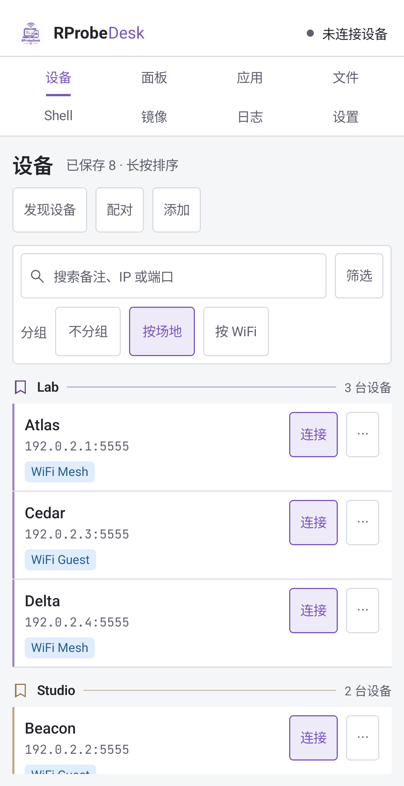</td>
    <td width="25%">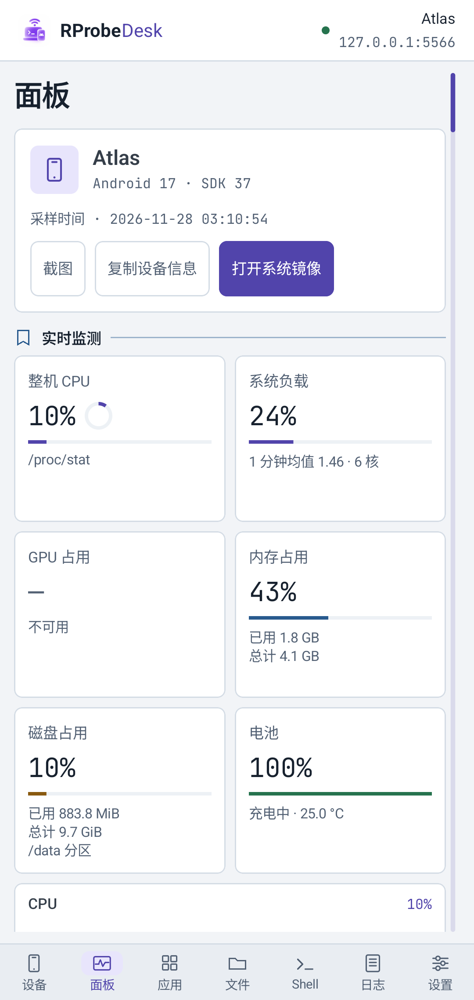</td>
    <td width="25%">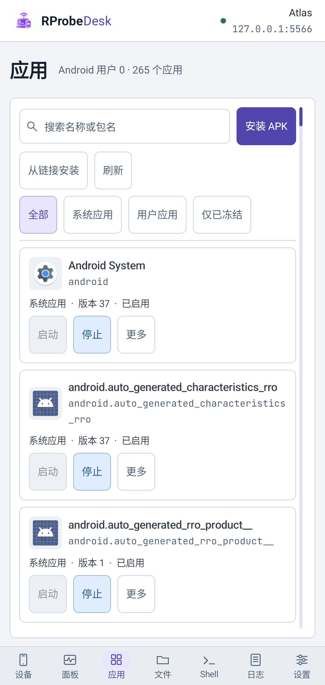</td>
    <td width="25%">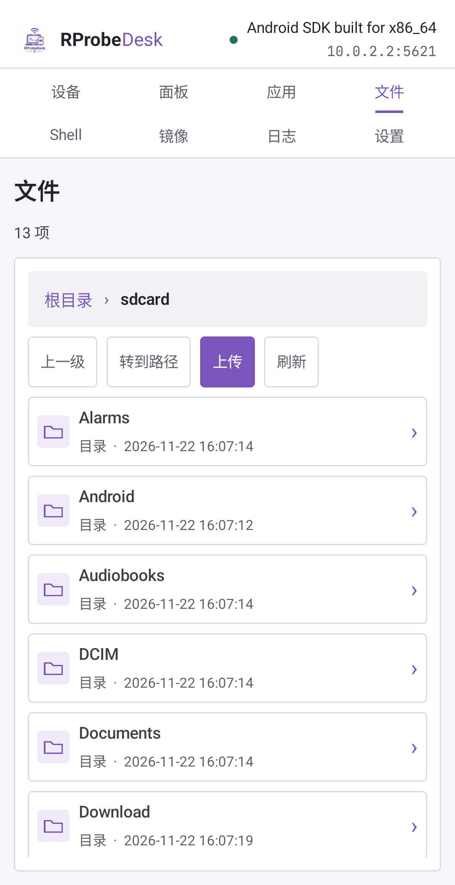</td>
  </tr>
  <tr>
    <td width="25%">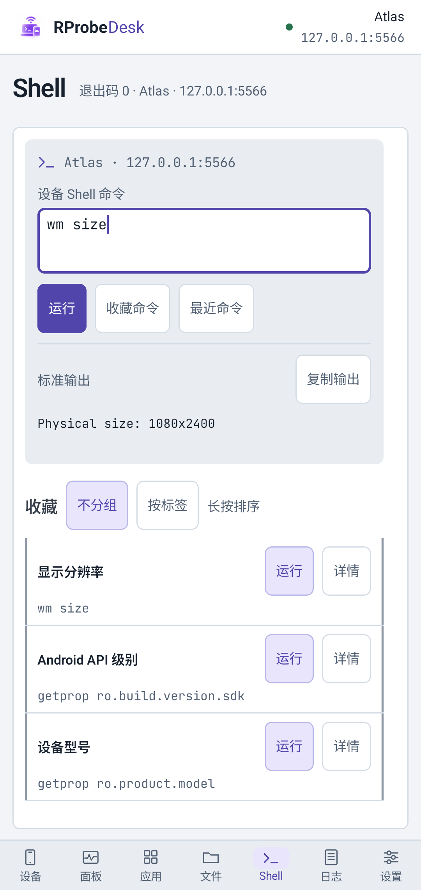</td>
    <td width="25%">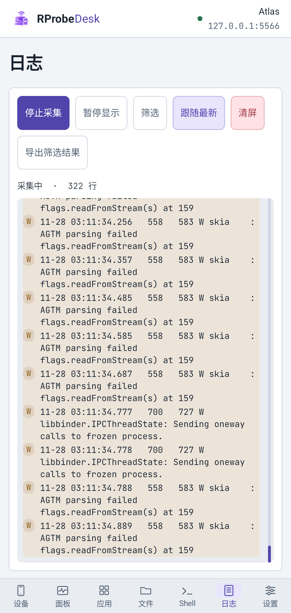</td>
    <td width="25%">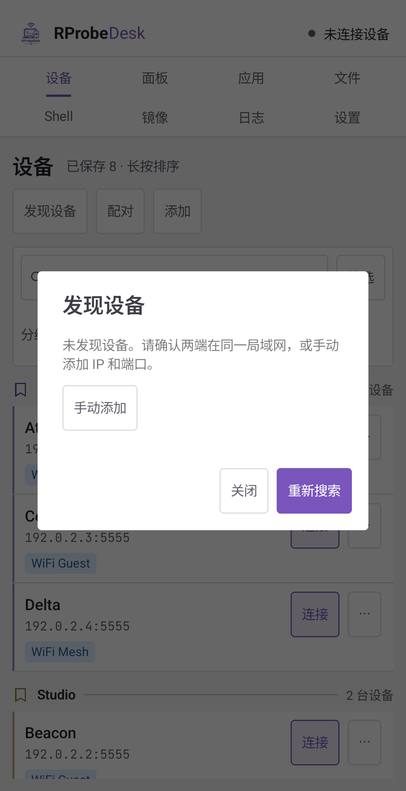</td>
    <td width="25%">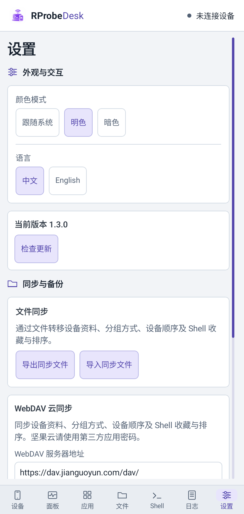</td>
  </tr>
</table>

## ✨ 功能

| 工作区 | 可以做什么 |
| --- | --- |
| 设备 | 发现局域网内的 ADB 服务、按配对码配对，或按 IP 和端口连接已开启 TCP 调试的设备。按备注、IP、端口搜索，按 WiFi 或场地筛选。可按场地或 WiFi 分组并在组内排序。编辑标签后，设备自动归入对应组。 |
| 面板 | 通过圆环查看 CPU、系统负载、GPU、内存和数据分区占用。可核对型号、Android 版本、SDK、ABI、IP、MAC、分辨率和电池信息，复制设备信息或保存目标屏幕截图。可用读数取决于目标设备。 |
| 应用 | 按名称、包名、系统应用、用户应用或冻结状态筛选。直接启动、停止应用，在「更多」中冻结、解冻或卸载。选择本地 APK 或输入单个 APK 的直链，核对包信息后安装。 |
| 文件 | 通过目录卡片和面包屑逐级浏览，直接跳转到路径，上传、下载或在同一存储卷内移动文件。覆盖同名文件前会要求确认。 |
| Shell | 在当前设备上执行命令，查看退出状态并复制输出。常用命令可命名、收藏和拖动排序，下次连接时可直接运行。 |
| 镜像 | Windows 使用独立的 scrcpy 窗口，Android 使用内置镜像视图。两端均可点击、拖动、输入文字和发送按键，画面跟随目标旋转。 |
| 日志 | 选择 logcat 缓冲区并开始采集。按等级、Tag、PID 或关键词筛选，按颜色区分日志等级，可暂停显示、跟随最新记录或导出筛选结果。 |
| 设置 | 切换语言和颜色模式。通过本地文件或 WebDAV 同步设备资料、标签、分组方式、完整设备顺序及 Shell 收藏与排序。导入文件前可核对记录数量，确认后替换本机记录。Windows 可设置 adb、scrcpy 路径，以及关闭窗口时退出还是收起到托盘。 |

<a id="quick-start"></a>

## 📥 快速开始

根据**主控端**选择安装包。目标设备只需开启系统无线调试或 ADB TCP 调试。[下载 v1.2.1](https://github.com/rurikacy/RProbeDesk/releases/tag/v1.2.1)

| 主控环境 | 安装包 | 准备工作 |
| --- | --- | --- |
| Windows x64 | [RProbeDesk-1.2.1-windows-x64.msi](https://github.com/rurikacy/RProbeDesk/releases/download/v1.2.1/RProbeDesk-1.2.1-windows-x64.msi) | 安装后即可连接和镜像。MSI 随附 Temurin 17、ADB 36.0.0、scrcpy 3.3.4 和匹配的服务端。需要使用其他工具时，可在设置中覆盖路径。 |
| Android 11 及以上 | [RProbeDesk-1.2.1-android.apk](https://github.com/rurikacy/RProbeDesk/releases/download/v1.2.1/RProbeDesk-1.2.1-android.apk) | 安装 APK 即可。主控使用包内的 ADB 客户端和镜像组件，无线调试在被控设备上开启。 |

下载完成后，可用 PowerShell 的 `Get-FileHash -Algorithm SHA256 .\RProbeDesk-1.2.1-windows-x64.msi` 与同一发行页的 [SHA256SUMS.txt](https://github.com/rurikacy/RProbeDesk/releases/download/v1.2.1/SHA256SUMS.txt) 核对。验证 APK 时替换文件名即可。

1. 让主控和目标处于可以互访的同一局域网。在目标的开发者选项中打开「无线调试」，或使用目标已启用的 ADB TCP 调试端口。
2. 在主控打开「设备 → 发现设备」。如果目标显示连接端口，点「连接」。支持传统 TCP 调试的目标也可手动输入 IP 和端口，例如 5555，在「设备 → 配对」中留空配对码并点「保存并连接」。若目标弹出 USB 调试授权，请在目标端确认。
3. 需要六位码时，在目标打开「使用配对码配对设备」。在主控选择发现的配对服务，或手动输入弹窗里的配对端口和六位码。配对成功后，返回目标无线调试主页，用那里显示的**连接端口**添加或连接设备。主控首次核对该目标身份时，按提示输入目标通知栏里的八位数字。
4. 连接后进入「面板」查看采样数据。重启无线调试或切换网络后，连接端口可能变化，可以重新发现设备或编辑已保存的地址。[Android 无线调试指南](https://developer.android.com/tools/adb#wireless)

**从旧版升级。** Windows 用户请先从托盘退出 RProbeDesk，再运行 1.2.1 MSI。安装程序会沿用原目录和配置。Android 1.2.1 的版本码为 24，沿用正式版 1.1.3 的签名，可直接覆盖升级。早期 v1.2.0 APK 和本地调试包使用其他证书；如需迁移，先导出设备资料与收藏并妥善保存。

## 🧭 日常使用

- **跨主控同步。** 本地文件和 WebDAV 使用 `RProbeDesk/3` 传递设备分组、设备顺序和 Shell 收藏顺序。导入 `RProbeDesk/1` 或 `RProbeDesk/2` 时，接收端保留已有 Shell 收藏的本机顺序。导入 `RProbeDesk/1` 时，也保留本机设备分组和已有设备的手动顺序。
- **Windows 托盘。** 收起到托盘后，单击图标恢复窗口，右键可选择打开或退出。再次双击桌面快捷方式也会将原窗口带到前台。

- **调试应用。** 在「应用」点「安装 APK」或「从链接安装」，确认目标用户和包信息。需要重现故障时，先在「日志」开始采集，再进入镜像操作。Android 主控在前台跨页期间持续采集，退到后台会记录中断，返回后可手动续采。
- **收藏命令。** 在「Shell」运行 `getprop ro.product.model`，可与面板型号对照。点「收藏命令」为命令命名，以后连接设备即可在收藏行点「运行」。
- **输入中文。** Android 主控在镜像工具栏点「输入文字」并发送。Windows 可复制文字，让镜像中的目标输入框获得焦点，再按 scrcpy 默认的 **左 Alt+V** 粘贴。
- **核对状态。** 温度注明测点，设备未公开的指标会显示缺失。冻结作用于目标当前 Android 用户，解冻可恢复。遇到断线后提示「结果待核实」，请重连原设备并刷新包列表或目标目录。

<a id="build"></a>

## 🔧 源码构建与测试

当前源码版本为 **1.2.2**，公开下载对应上方的 1.2.1。1.2.2 的会话架构、构建参数与验收数据见[架构与验收记录](docs/architecture-1.2.2.md)。本轮的设备发现、并发限制和日志预算详见[第三阶段工程验收](docs/architecture-1.2.3.md)。

源码构建使用稳定版 Rust。准备 Cargo、Windows x64 C 编译器和链接器（用于编译 ring）和 Android NDK r27c，设置 `ANDROID_NDK_HOME`。Gradle 编译 Rust 库并核验 Windows 工具归档的 SHA-256。依赖可预置于 `app/build/windowsToolDownloads/`。

```powershell
rustup target add aarch64-linux-android armv7-linux-androideabi i686-linux-android x86_64-linux-android
cargo test --locked --manifest-path native/Cargo.toml
```

在 Windows x64 开发机上准备 JDK 17、Android SDK Platform 35 与 Build Tools。设置 `ANDROID_HOME`，或在未纳入版本控制的 `local.properties` 中填写 `sdk.dir=C:/Android/Sdk`。构建 MSI 还需要 WiX 3.x 的 `candle.exe` 和 `light.exe` 在 `PATH` 中可用。工程自带 Gradle Wrapper。[JDK 17 打包前提](https://docs.oracle.com/en/java/javase/17/jpackage/packaging-overview.html)

```powershell
.\gradlew.bat :app:run                            # 从源码运行 Windows 工作台
.\gradlew.bat :app:desktopTest                    # 共享逻辑、桌面端与 Compose 界面测试
.\gradlew.bat :app:assembleDebug                  # Android 调试 APK
.\gradlew.bat :app:packageDistributionForCurrentOS # Windows MSI
```

MSI 生成在 `app/build/compose/binaries/main/msi/`，调试 APK 在 `app/build/outputs/apk/debug/`。正式构建运行 `.\gradlew.bat :app:assembleRelease -PrprobeAbiApks=true`，生成通用 APK 和四种独立 ABI 包。release 默认启用 R8 和资源压缩。签名配置读取 `RPROBE_KEYSTORE`、`RPROBE_STORE_PASSWORD`，并支持 `RPROBE_KEY_ALIAS` 与 `RPROBE_KEY_PASSWORD`。覆盖升级 Android 应用时，新旧版本须使用同一签名身份。

设备与界面逻辑位于 `app/src/shared/kotlin/`，平台适配分别位于 `app/src/desktopMain/` 与 `app/src/androidMain/`。涉及真实 ADB 的测试需要显式指定专用模拟器，测试应用可通过 `.\gradlew.bat :qa:fixture:assembleDebug` 生成。仓库包含双设备配对、镜像、文件传输和日志负载的复验步骤。[Android 无线调试验收](qa/android-wireless/README.md) · [Windows 镜像验收](qa/windows-mirror/README.md)

## 🤝 参与与反馈

反馈时请附上 RProbeDesk 版本、主控平台、目标 Android 版本和复现步骤。涉及连接问题时，注明使用配对端口还是连接端口，并隐去配对码和日志中的个人信息。[使用支持](SUPPORT.md) · [提交 Issue](https://github.com/rurikacy/RProbeDesk/issues)

参与开发前可阅读贡献指南和行为准则。安全问题请通过安全说明中的渠道报告。[贡献指南](CONTRIBUTING.md) · [行为准则](CODE_OF_CONDUCT.md) · [安全说明](SECURITY.md) · [版本记录](CHANGELOG.md)

## 📄 许可证

RProbeDesk 项目代码采用 GNU Affero General Public License v3。随包提供的第三方库、scrcpy server 和字体分别保留其上游许可。[项目许可证](LICENSE.txt) · [第三方声明](THIRD-PARTY-NOTICES.md) · [Android 组件与原始许可](app/src/androidMain/assets/licenses/COMPONENTS.txt) · [字体许可](app/src/commonMain/composeResources/files/licenses/jetbrains_mono-OFL.txt)
