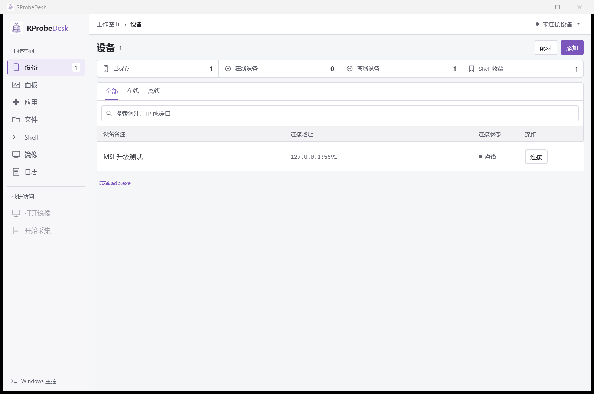
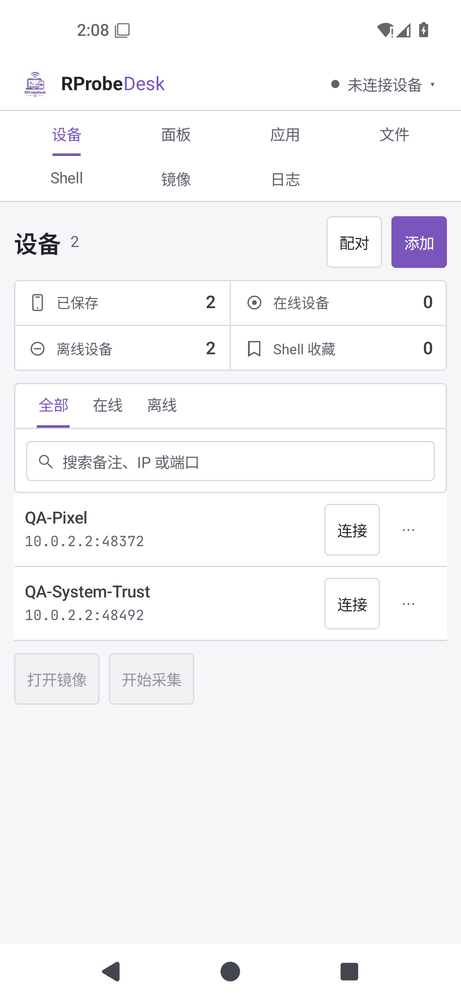

<div align="center">
  
  <h1>RProbeDesk</h1>
  <p>A wireless ADB workbench for Windows and Android</p>
  <p>
    
    
    
    
  </p>
  <p>by <a href="https://github.com/rurikacy">Rurikacy</a> · <a href="README.md">简体中文</a></p>
  <p><a href="https://github.com/rurikacy/RProbeDesk/releases">Releases</a> · <a href="#screenshots">Screenshots</a> · <a href="#quick-start">Quick start</a> · <a href="#build">Build from source</a> · <a href="SUPPORT.md">Support</a></p>
</div>

---

## 📖 About

Use a Windows PC or an Android phone or tablet to debug another Android device over Wi-Fi ADB. Install a test build in Apps, reproduce a problem in the screen mirror, then open Logs to export the error. The toolbar shows the label of the device you are controlling.

The two editions share their Kotlin device management code and Compose Multiplatform interface. Commands and files travel directly between the host and the target. The interface is in Simplified Chinese and uses a light theme.

<a id="screenshots"></a>

## 🖼️ Screenshots

**Windows workbench**

<p align="center"></p>

**Android workbench**

<p align="center"></p>

## ✨ Features

| Workspace | What you can do |
| --- | --- |
| Devices (设备) | Pair and connect by IP address and port. Label devices, search your saved list and switch the active target. |
| Dashboard (面板) | Check CPU usage, used and total memory, battery temperature, device model and Android version. Copy device details or save a screenshot of the target. |
| Apps (应用) | Find an app by package name, launch or stop it, freeze or unfreeze it, or uninstall it. Install a local APK or download a single APK from a direct link and review its source, package name and version before installing. |
| Files (文件) | Browse the target, transfer files in either direction and move files within the same target volume. Confirm before replacing a file. On Android, select local files and save locations with the system file picker. |
| Shell | Run commands on the target, inspect their output and exit status, and name and save commands for reuse. |
| Mirror (镜像) | Tap, drag, enter text and send keys in a separate Windows window or the Android mirror view. The picture follows the target's rotation. |
| Logs (日志) | Start logcat capture and filter by level, tag, PID or keyword. Read color-coded entries and stack traces, pause the display and export matching entries. |

<a id="quick-start"></a>

## 📥 Quick start

Install RProbeDesk on the **host** you will use to control the target. The target uses Android's built-in wireless debugging. Connect both devices to the same Wi-Fi network and ensure it allows connections between them. [Download v1.2.0](https://github.com/rurikacy/RProbeDesk/releases/tag/v1.2.0)

| Host | Installer | Requirements |
| --- | --- | --- |
| Windows x64 | `RProbeDesk-1.2.0-windows-x64.msi` | The MSI includes a Temurin 17 runtime. Install Android SDK Platform-Tools for `adb.exe`. Screen mirroring also needs `scrcpy.exe`. You can select their paths in Devices and Mirror, respectively. [Platform-Tools](https://developer.android.com/tools/releases/platform-tools) · [scrcpy for Windows](https://github.com/Genymobile/scrcpy/blob/v3.3.4/doc/windows.md) |
| Android 11 or later | `RProbeDesk-1.2.0-android.apk` | Install the APK. The host includes its ADB client and mirror components. Enable wireless debugging on the target. |

To verify the download, run `Get-FileHash -Algorithm SHA256 .\RProbeDesk-1.2.0-windows-x64.msi` in PowerShell and compare the result with `SHA256SUMS.txt` on the same release page. Substitute the APK filename to check the Android package.

1. On the **target**, open **Settings → Developer options → Wireless debugging** and approve the current network. Note the **IP address and connection port** on the main wireless debugging screen. Phones and tablets running Android 11 or later support system pairing codes. [Android wireless debugging guide](https://developer.android.com/tools/adb#wireless)
2. On the target, choose **Pair device with pairing code** and leave the dialog open. On the **host**, open RProbeDesk and choose **设备 → 配对** (Devices → Pair). Enter the target IP and the **pairing port** and **six-digit code** from the dialog. If it expires, reopen it and use the new port and code.
3. On the host, choose **设备 → 添加** (Devices → Add). Enter the IP, the **connection port** from the main wireless debugging screen and a label such as “Test tablet”, then save.
4. Choose **连接** (Connect) beside the saved device. When an Android host first verifies a target's identity, enter the eight digits shown in the target's notification. Once connected, open **面板** (Dashboard) to check the model and see live readings.

The connection port may change when you restart wireless debugging or switch networks. Edit the saved device and reconnect. To revoke a host's authorization, forget it under **Wireless debugging → Paired devices** on the target.

## 🧭 Everyday use

- **Debug an app.** In Apps, install an APK from a file or a link and review the Android user and package details. Start capturing in Logs before opening Mirror to reproduce a problem. On an Android host, capture continues while you switch workspaces. Moving the app to the background marks an interruption. Resume capture manually when you return.
- **Save a command.** Run `getprop ro.product.model` in Shell and compare the result with the Dashboard. Select **收藏命令** to name the command. Once connected, choose **运行** beside it to run it again.
- **Enter Chinese text.** On an Android host, select **输入文字** in the mirror toolbar and send the text. On Windows, copy the text, focus the target's text field in the mirror, then use scrcpy's default **Left Alt+V** to paste.
- **Interpret device state.** The Dashboard names the temperature sensor and marks unavailable readings. Freezing an app affects the current Android user and can be reversed. If a disconnect leaves an operation marked **结果待核实** (result unverified), reconnect to the same device and refresh the package list or destination folder.

<a id="build"></a>

## 🔧 Build and test

On a Windows x64 development machine, install JDK 17, Android SDK Platform 35 and Android SDK Build Tools. Set `ANDROID_HOME` or add `sdk.dir=C:/Android/Sdk` to a local, untracked `local.properties`. To build the MSI, put the WiX 3.x tools `candle.exe` and `light.exe` on `PATH`. Use the included Gradle Wrapper. [JDK 17 packaging prerequisites](https://docs.oracle.com/en/java/javase/17/jpackage/packaging-overview.html)

```powershell
.\gradlew.bat :app:run                            # Run the Windows workbench from source
.\gradlew.bat :app:desktopTest                    # Shared logic, desktop and Compose UI tests
.\gradlew.bat :app:assembleDebug                  # Android debug APK
.\gradlew.bat :app:packageDistributionForCurrentOS # Windows MSI
```

Find the MSI in `app/build/compose/binaries/main/msi/` and the debug APK in `app/build/outputs/apk/debug/`. To sign a release APK, set `RPROBE_KEYSTORE` and `RPROBE_STORE_PASSWORD`, use the alias `rprobedesk` with the same key and store password, and run `.\gradlew.bat :app:assembleRelease`. Android requires the same signing identity for in-place upgrades.

Shared device logic and UI live in `app/src/shared/kotlin/`. Platform adapters live in `app/src/desktopMain/` and `app/src/androidMain/`. Tests using live ADB require an explicitly selected lab emulator. Build the fixture with `.\gradlew.bat :qa:fixture:assembleDebug`. The repository includes procedures for pairing two devices, screen mirroring, file transfers and log load testing. [Android wireless debugging tests](qa/android-wireless/README.md) · [Windows mirror tests](qa/windows-mirror/README.md)

## 🧪 Compatibility

Tests cover Windows 11 x64 and Android 11 and 15 x86_64 emulators, including wireless pairing, replacing a target at the same address, revoking authorization, installing signed APKs and log capture. Windows tests used Platform-Tools 37.0.1 and scrcpy 3.3.4. Physical ARM devices, vendor-specific debugging permissions and temperature sensors, and mirroring latency on a physical Wi-Fi network still need testing. [Target identity and revoked authorization](qa/android-wireless/trust/README.md) · [Log load and memory measurements](qa/android-wireless/logcat/README.md)

## 🤝 Contributing and support

When reporting a problem, include the RProbeDesk version, host platform, target Android version and steps to reproduce it. For connection issues, specify whether you used the pairing or connection port. Remove pairing codes and personal information from logs before sharing. [Support](SUPPORT.md) · [Open an issue](https://github.com/rurikacy/RProbeDesk/issues)

Read the contribution guide and code of conduct before contributing. Report security issues through the channel described in the security policy. [Contributing](CONTRIBUTING.md) · [Code of conduct](CODE_OF_CONDUCT.md) · [Security policy](SECURITY.md) · [Changelog](CHANGELOG.md)

## 📄 License

RProbeDesk project code is licensed under the GNU Affero General Public License v3. Bundled libraries, the scrcpy server and fonts retain their upstream licenses. [Project license](LICENSE.txt) · [Third-party notices](THIRD-PARTY-NOTICES.md) · [Android components and original licenses](app/src/androidMain/assets/licenses/COMPONENTS.txt) · [Font license](app/src/commonMain/composeResources/files/licenses/jetbrains_mono-OFL.txt)
