<div align="center">
  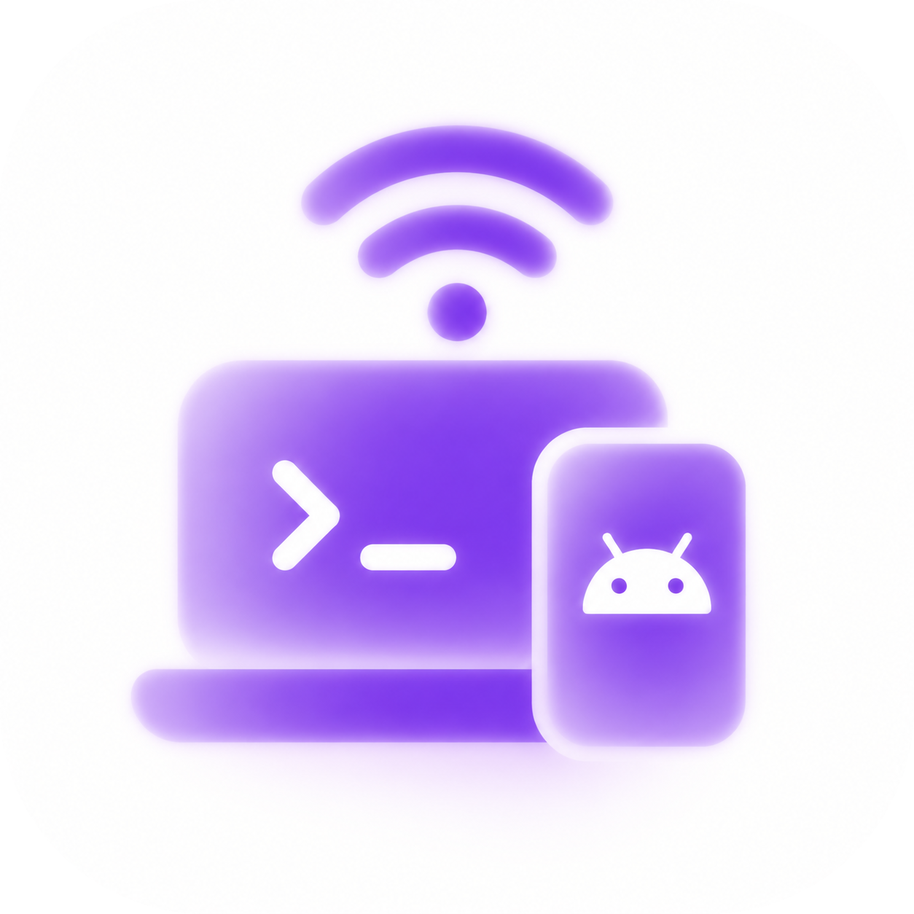
  <h1>RProbeDesk</h1>
  <p>A wireless ADB workbench for Windows and Android</p>
  <p>
    
    
    
    
  </p>
  <p>by <a href="https://github.com/rurikacy">Rurikacy</a> · <a href="README.md">简体中文</a></p>
  <p><a href="https://github.com/rurikacy/RProbeDesk/releases/tag/v1.0.0">Download 1.0.0</a> · <a href="#screenshots">Screenshots</a> · <a href="#quick-start">Quick start</a> · <a href="#build">Build from source</a> · <a href="SUPPORT.md">Support</a></p>
</div>

---

## 📖 About

Use a Windows PC or an Android phone or tablet to debug another Android device over Wi-Fi ADB. Install a test build in Apps, reproduce a problem in the screen mirror, then open Logs to export the error. Once connected, the top bar shows the target’s name, IP address and port.

The two editions share their Kotlin device management code and Compose Multiplatform interface. Commands and files travel directly between the host and the target. The interface supports Simplified Chinese and English and uses a light theme.

<a id="screenshots"></a>

## 🖼️ Screenshots

**Windows workbench**

<table>
  <tr>
    <td width="50%"><a href="docs/screenshots/en/devices.png">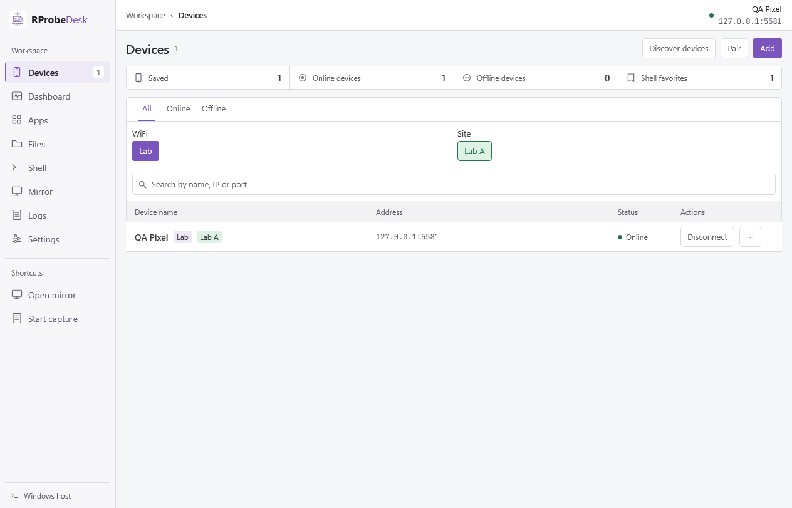</a></td>
    <td width="50%"><a href="docs/screenshots/en/dashboard.png">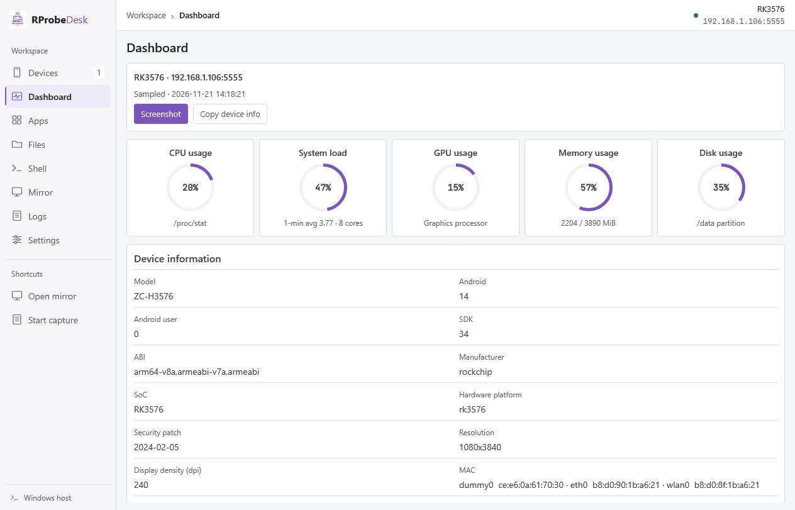</a></td>
  </tr>
  <tr>
    <td width="50%"><a href="docs/screenshots/en/apps.png">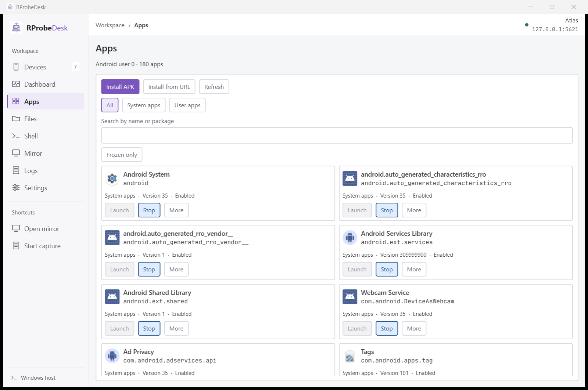</a></td>
    <td width="50%"><a href="docs/screenshots/en/files.png">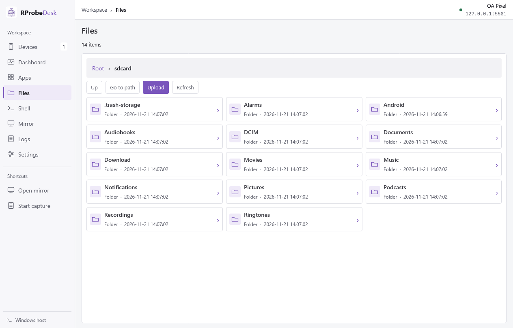</a></td>
  </tr>
  <tr>
    <td width="50%"><a href="docs/screenshots/en/shell.png">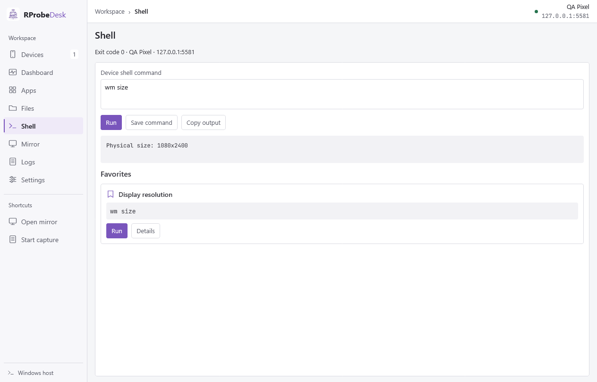</a></td>
    <td width="50%"><a href="docs/screenshots/en/logs.png">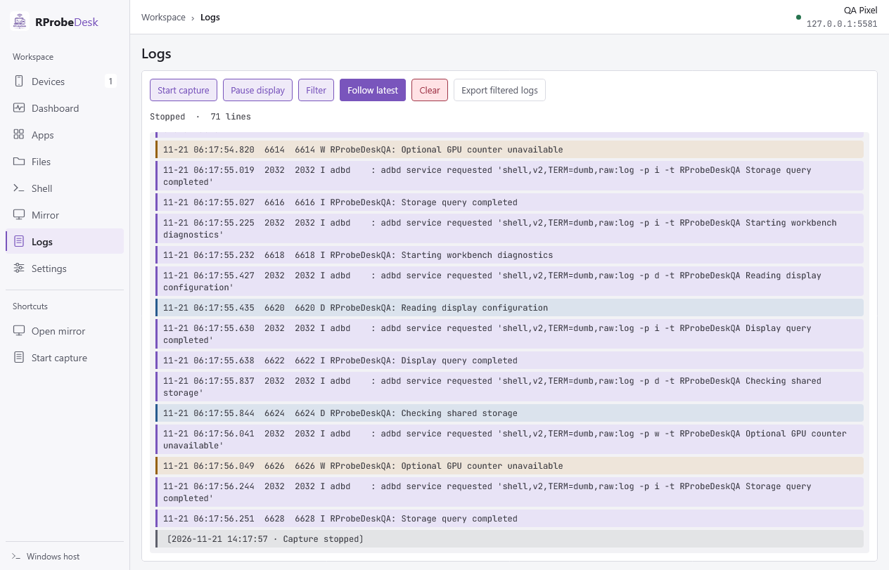</a></td>
  </tr>
  <tr>
    <td width="50%"><a href="docs/screenshots/en/discovery.png">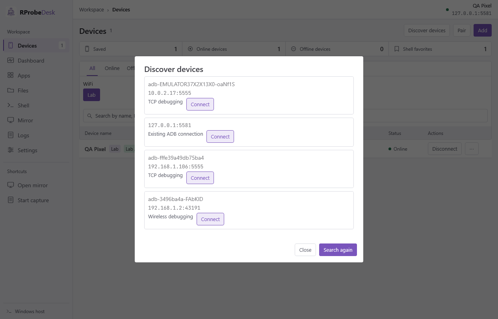</a></td>
    <td width="50%"><a href="docs/screenshots/en/settings.png">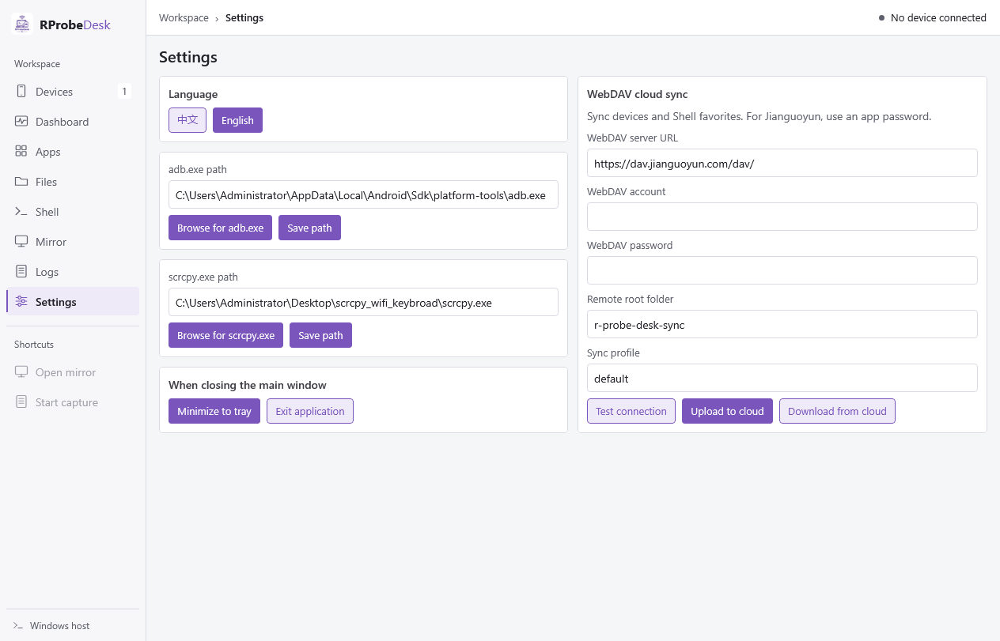</a></td>
  </tr>
</table>

**Android workbench**

<table>
  <tr>
    <td width="33%"><a href="docs/screenshots/en/android/devices.png">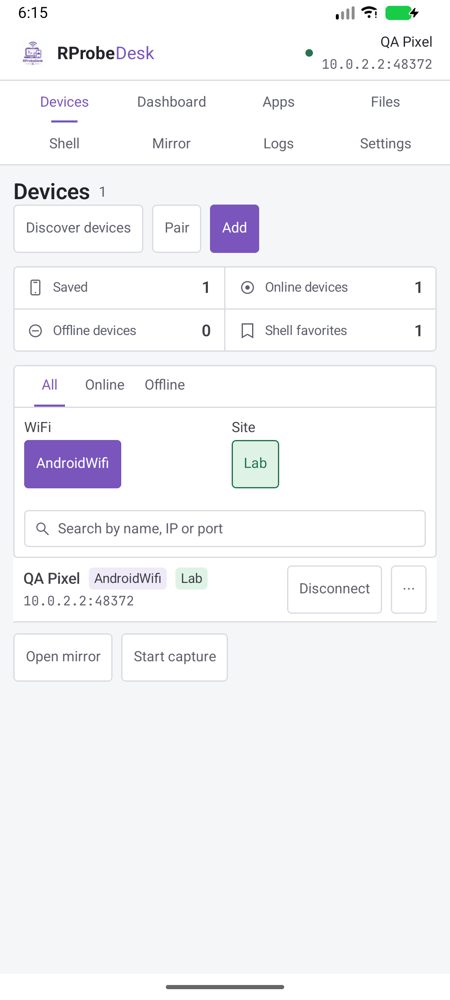</a></td>
    <td width="33%"><a href="docs/screenshots/en/android/dashboard.png">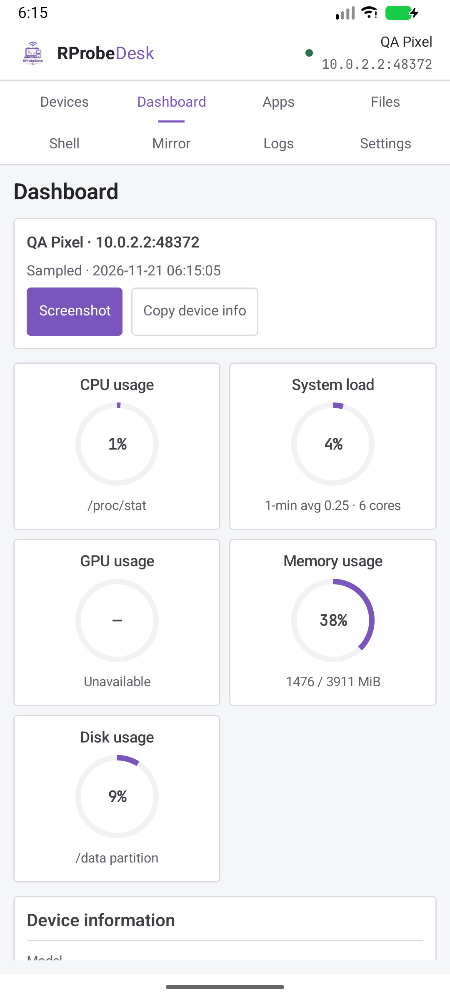</a></td>
    <td width="33%"><a href="docs/screenshots/en/android/apps.png">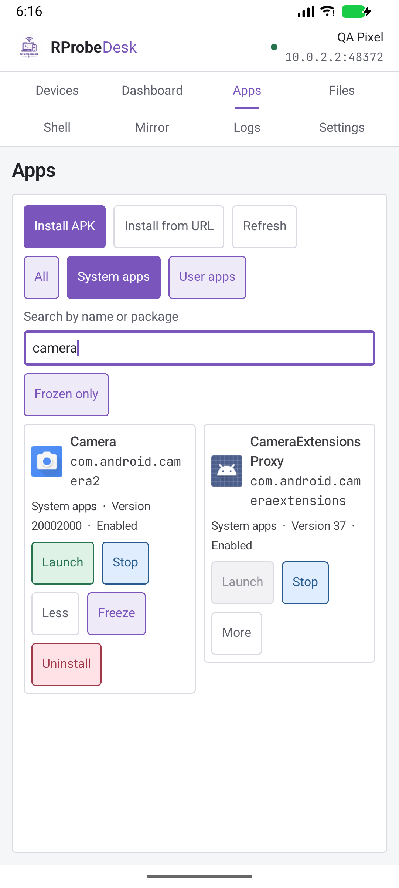</a></td>
  </tr>
  <tr>
    <td width="33%"><a href="docs/screenshots/en/android/files.png">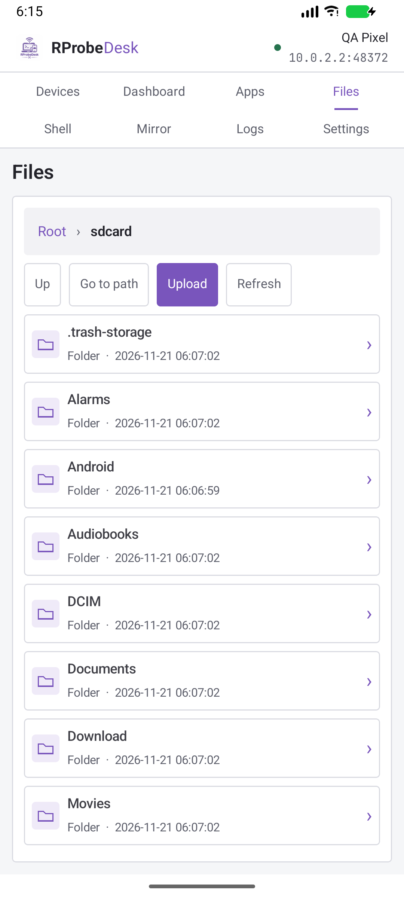</a></td>
    <td width="33%"><a href="docs/screenshots/en/android/shell.png">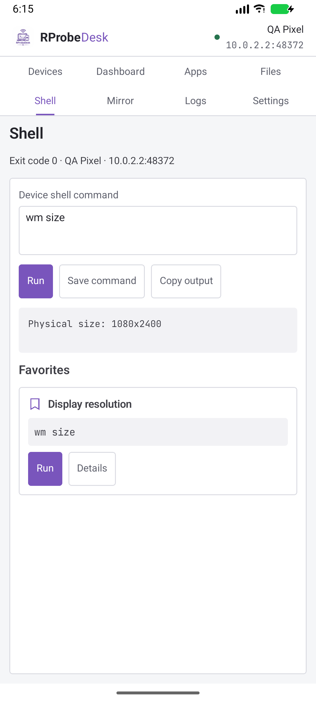</a></td>
    <td width="33%"><a href="docs/screenshots/en/android/logs.png">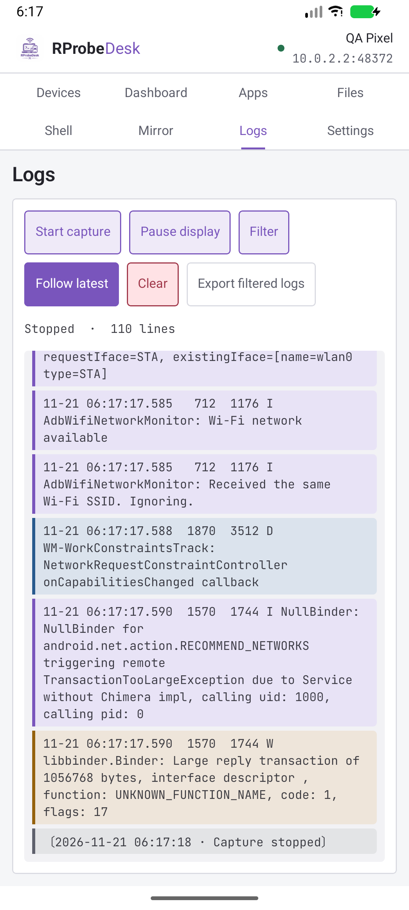</a></td>
  </tr>
  <tr>
    <td width="33%"><a href="docs/screenshots/en/android/discovery.png">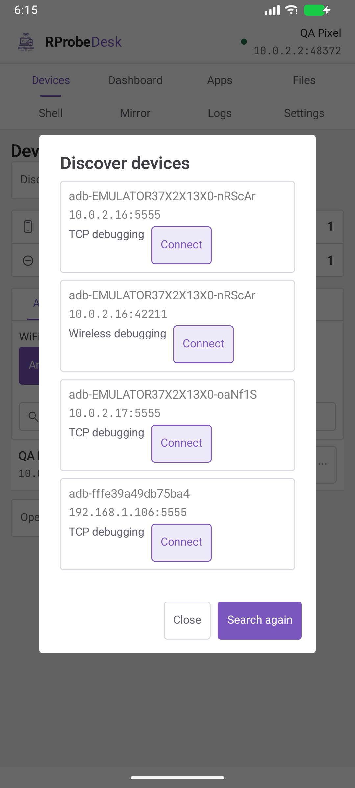</a></td>
    <td width="33%"><a href="docs/screenshots/en/android/settings.png">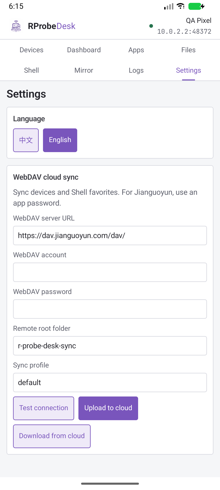</a></td>
  </tr>
</table>

## ✨ Features

| Workspace | What you can do |
| --- | --- |
| Devices | Discover advertised ADB services on the local network or enter an IP address and port. Connect with a pairing code or an enabled TCP debugging port. Search by name, IP or port and filter by status, WiFi or site. The top bar shows the active device and address. |
| Dashboard | Read CPU usage, system load, GPU, memory and data partition usage in ring gauges. Inspect the model, Android version, SDK, ABI, IP and MAC addresses, resolution and battery. Copy device details or save a target screenshot. Available readings depend on the target. |
| Apps | Search by name or package and filter system, user or frozen apps. Launch and stop apps from the list. Open **More** to freeze, unfreeze or uninstall. Review and install a single APK from a local file or direct URL. |
| Files | Browse folders with breadcrumbs, jump to a path, upload or download files, and move files within the same target volume. Confirm before overwriting a file. |
| Shell | Run commands on the target, read the exit status and copy the output. Save named commands and run them from their favorite cards. |
| Mirror | Control the target in a separate scrcpy window on Windows or in the built-in Android mirror. Tap, drag, enter text or send keys as the picture follows the target’s rotation. |
| Logs | Choose a logcat buffer and capture entries. Filter by level, tag, PID or keyword, read color-coded entries, pause the display, follow the latest entries or export the filtered results. |
| Settings | Switch between English and Simplified Chinese. Manually sync devices, tags and Shell favorites using WebDAV. On Windows, configure adb and scrcpy paths and choose whether closing the window exits or minimizes to the tray. |

<a id="quick-start"></a>

## 📥 Quick start

Choose the installer for the **host** you will use to control the target. On the target, enable built-in wireless debugging or ADB over TCP. [Download v1.0.0](https://github.com/rurikacy/RProbeDesk/releases/tag/v1.0.0)

| Host | Installer | Requirements |
| --- | --- | --- |
| Windows x64 | [RProbeDesk-1.0.0-windows-x64.msi](https://github.com/rurikacy/RProbeDesk/releases/download/v1.0.0/RProbeDesk-1.0.0-windows-x64.msi) | The MSI includes a Temurin 17 runtime. Install Android SDK Platform-Tools for `adb.exe`. Screen mirroring also needs `scrcpy.exe`. Enter or browse for both paths in Settings. [Platform-Tools](https://developer.android.com/tools/releases/platform-tools) · [scrcpy for Windows](https://github.com/Genymobile/scrcpy/blob/v3.3.4/doc/windows.md) |
| Android 11 or later | [RProbeDesk-1.0.0-android.apk](https://github.com/rurikacy/RProbeDesk/releases/download/v1.0.0/RProbeDesk-1.0.0-android.apk) | Install the APK. The host includes its ADB client and mirror components. Enable wireless debugging on the target. |

To verify the download, run `Get-FileHash -Algorithm SHA256 .\RProbeDesk-1.0.0-windows-x64.msi` in PowerShell and compare the result with [SHA256SUMS.txt](https://github.com/rurikacy/RProbeDesk/releases/download/v1.0.0/SHA256SUMS.txt) on the same release page. Substitute the APK filename to check the Android package.

1. Put the host and target on the same local network with direct connectivity. Enable **Wireless debugging** in the target’s developer options or use an ADB TCP port already enabled on the target.
2. Open **Devices → Discover devices** on the host and select **Connect** beside a connection service. For classic TCP debugging, you can also open **Devices → Pair**, enter the target’s IP and port (often 5555), leave the pairing code empty and choose **Save and connect**. Approve the debugging prompt on the target if it appears.
3. If the target requires a six-digit code, open **Pair device with pairing code** on the target. Choose the discovered pairing service on the host or enter the pairing port and code from that dialog. After pairing, return to the main wireless debugging screen and use its **connection port** to add or connect the device. When an Android host first asks to verify the target, enter the eight digits shown in the target’s notification.
4. Open **Dashboard** to see live readings. If the port changes after a network switch or wireless debugging restart, rediscover the device or edit the saved address. [Android wireless debugging guide](https://developer.android.com/tools/adb#wireless)

On Windows, exit RProbeDesk from the tray before running the 1.0.0 MSI. The GitHub v1.2.0 APK used a different signing certificate. Back up any device records and commands you need before uninstalling that APK. A locally installed Android build with the same release signature and a lower version code can be updated in place. This release uses version code 12.

## 🧭 Everyday use

- **Windows tray.** Click the tray icon once to restore the window. Right-click it to open or exit. Launching the shortcut again brings the existing window to the foreground.

- **Debug an app.** In Apps, install an APK from a file or a link and review the Android user and package details. Start capturing in Logs before opening Mirror to reproduce a problem. On an Android host, capture continues while you switch workspaces. Moving the app to the background marks an interruption. Resume capture manually when you return.
- **Save a command.** Run `getprop ro.product.model` in Shell and compare the result with the Dashboard. Select **Save command** to name the command. Once connected, choose **Run** beside it to run it again.
- **Enter Chinese text.** On an Android host, select **Enter text** in the mirror toolbar and send the text. On Windows, copy the text, focus the target's text field in the mirror, then use scrcpy's default **Left Alt+V** to paste.
- **Interpret device state.** The Dashboard names the temperature sensor and marks unavailable readings. Freezing an app affects the current Android user and can be reversed. If a disconnect leaves an operation marked **Result unverified**, reconnect to the same device and refresh the package list or destination folder.

<a id="build"></a>

## 🔧 Build and test

On a Windows x64 development machine, install JDK 17, Android SDK Platform 35 and Android SDK Build Tools. Set `ANDROID_HOME` or add `sdk.dir=C:/Android/Sdk` to a local, untracked `local.properties`. To build the MSI, put the WiX 3.x tools `candle.exe` and `light.exe` on `PATH`. Use the included Gradle Wrapper. [JDK 17 packaging prerequisites](https://docs.oracle.com/en/java/javase/17/jpackage/packaging-overview.html)

```powershell
.\gradlew.bat :app:run                            # Run the Windows workbench from source
.\gradlew.bat :app:desktopTest                    # Shared logic, desktop and Compose UI tests
.\gradlew.bat :app:assembleDebug                  # Android debug APK
.\gradlew.bat :app:packageDistributionForCurrentOS # Windows MSI
```

Find the MSI in `app/build/compose/binaries/main/msi/` and the debug APK in `app/build/outputs/apk/debug/`. To sign a release APK, set `RPROBE_KEYSTORE` and `RPROBE_STORE_PASSWORD`, use the alias `rprobedesk` with the same key and store password, and run `.\gradlew.bat :app:assembleRelease`. Android requires the same signing identity for in-place upgrades.

Shared device logic and UI live in `app/src/shared/kotlin/`. Platform adapters live in `app/src/desktopMain/` and `app/src/androidMain/`. Tests using live ADB require an explicitly selected lab emulator. Build the fixture with `.\gradlew.bat :qa:fixture:assembleDebug`. The repository includes procedures for pairing two devices, screen mirroring, file transfers and log load testing. [Android wireless debugging tests](qa/android-wireless/README.md) · [Windows mirror tests](qa/windows-mirror/README.md)

## 🤝 Contributing and support

When reporting a problem, include the RProbeDesk version, host platform, target Android version and steps to reproduce it. For connection issues, specify whether you used the pairing or connection port. Remove pairing codes and personal information from logs before sharing. [Support](SUPPORT.md) · [Open an issue](https://github.com/rurikacy/RProbeDesk/issues)

Read the contribution guide and code of conduct before contributing. Report security issues through the channel described in the security policy. [Contributing](CONTRIBUTING.md) · [Code of conduct](CODE_OF_CONDUCT.md) · [Security policy](SECURITY.md) · [Changelog](CHANGELOG.md)

## 📄 License

RProbeDesk project code is licensed under the GNU Affero General Public License v3. Bundled libraries, the scrcpy server and fonts retain their upstream licenses. [Project license](LICENSE.txt) · [Third-party notices](THIRD-PARTY-NOTICES.md) · [Android components and original licenses](app/src/androidMain/assets/licenses/COMPONENTS.txt) · [Font license](app/src/commonMain/composeResources/files/licenses/jetbrains_mono-OFL.txt)
